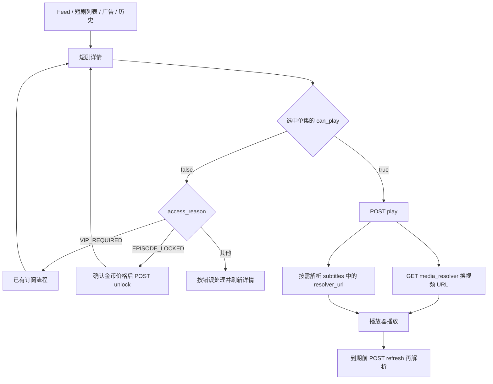

# 短剧跨 App 接口对接指南与开发提示词

更新时间：2026-11-26。适用：Android、iOS、Flutter、React Native、Web 等消费端。

## 阅读与版本边界

本文可作为单独 Markdown 文件交给其他 App 的开发者或开发 Agent，不依赖本仓库才能阅读。

- **接口参考基线**：2026-11-17《短剧 C 端接口与调用顺序》，并与本项目 `45f035e` 的请求、解析及播放实现交叉核对。
- **客户端行为基线**：截至 2026-11-26 的 Android 实现，包含预加载、完整播放、付费恢复、字幕同步与默认首条字幕。
- **核验范围**：本地接口调用与模型、现有接口说明、客户端回归。未重新核验目标 App 的线上后端、来源包配置、钱包或订阅平台；这些应在新 App 联调时确认。
- 下文 ID、签名地址、授权和时间均为示意，不能直接作为可用凭证。示例到期时间不代表固定到期时间；使用实际响应。
- 第 1～14 节是接口参考；第 15 节区分当前 App 产品策略；第 16～19 节用于实施、验收及直接复制提示词。
- 新 App 须配置自己的 API 环境、登录身份、包标识、支付/订阅接入；不要复制本项目 SDK 密钥、JWT、私有文件或平台商品配置。

## 1. 接入约定

| 项目 | 说明 |
|---|---|
| 测试服务地址 | `https://test.appjoly.com`，来自现有客户端环境配置 |
| HTTP 路径 | 下文均写完整 `/api/v1/...`；不要重复拼接 `/api/v1` |
| 鉴权 | 所有本文 API，包括预览、视频、字幕解析，都带 `Authorization: Bearer <客户端 JWT>` |
| POST 请求 | `Content-Type: application/json`；无业务参数的请求可发送 `{}` |
| 用户、App、A/B 面 | 用户和 App 从登录身份取得，A/B 面由服务端判定；无需传 `user_id`、`app_id`、`side` |
| 引用其他包 | 服务端解析当前 App 的短剧/广告来源。客户端仍使用当前用户 JWT，不切换到来源包身份 |
| 时间 | ISO 8601 UTC 字符串，按返回的 `expires_at` 判断授权到期 |
| 金额 | 金币整数；`currency` 固定为 `coins`。`null` 表示未配置，`0` 才表示免费 |
| 成功封装 | HTTP 200，业务对象在 `data` 中；这些接口成功响应通常**没有** `code: 0` |

短剧接口失败示例：

```json
{"code":"VIP_REQUIRED","message":"VIP_REQUIRED","data":null}
```

鉴权中间件和 Feed 错误封装可能不同，应同时检查 HTTP 状态及 `code`，不要要求所有错误都有 `data`。

## 2. 先看完整调用顺序

### 2.1 首页 Feed 进入短剧

以下为通用显式播放流程。当前 App 也允许当前可见且 `can_play=true` 的单集在首页走正式播放，具体边界见第 15.2 节；离屏预加载不适用该例外。

1. `GET /api/v1/resource-catalog/home-feed` 获取混排条目。
2. 遇到 `kind=short_drama`：用 `cover_url` 展示海报；如有 `details.preview`，可解析并播放短预览。
3. 对实际展示过的条目发送 Feed ACK；ACK 只记录 Feed 展示，不代表短剧播放。
4. 用户点击短剧，以 `resource_id` 调短剧详情，取得单集列表、价格和当前用户权限。
5. 选择单集；如缺 VIP，走客户端已有订阅流程；如缺金币解锁，先确认价格再调用 `unlock`。
6. 调 `play` 获取本次正式播放授权，再解析 `media_resolver` 得到视频签名 URL；按需解析字幕 URL。
7. 播放地址即将过期时，调 `refresh` 后重新解析；退出页面后停止自动刷新。

### 2.2 短剧列表、广告、历史入口

| 入口 | 调用顺序 |
|---|---|
| 短剧列表 | `/short-dramas` → `/short-dramas/{drama}` → 必要时订阅/解锁 → `play` → 视频/字幕解析 |
| 广告播放按钮 | `/short-drama-ads` → 按广告 `drama_id` 请求详情 → 客户端选择单集 → 后续播放流程 |
| 广告订阅按钮 | `/short-drama-ads` → 客户端现有订阅页 → 订阅状态同步后重新请求详情/播放授权 |
| 历史继续看 | `/short-dramas/history` → 读取 `last_episode_id` → 请求详情确认最新权限 → 必要时订阅/解锁 → `play` |



## 3. 接口总表

下表路径都在 `/api/v1` 下；所有接口都需要客户端 JWT。

| 用途 | 方法 | 路径 | 主要业务影响 |
|---|---|---|---|
| 首页 Feed | GET | `/resource-catalog/home-feed` | 获取或重放待展示批次 |
| Feed 展示确认 | POST | `/resource-catalog/home-feed/{batch_id}/ack` | 推进 Feed 展示进度 |
| 通用资源目录 | GET | `/resource-catalog/items` | 查询首页候选资源 |
| 独立短剧列表 | GET | `/short-dramas` | 查询短剧，可过滤标签、首页/VIP内容 |
| 短剧详情 | GET | `/short-dramas/{drama}` | 查询所有可用单集和当前权限 |
| 广告列表 | GET | `/short-drama-ads` | 查询当前可见广告 |
| 单集解锁 | POST | `/short-dramas/{drama}/episodes/{episode}/unlock` | 首次付费解锁扣金币 |
| 单集播放授权 | POST | `/short-dramas/{drama}/episodes/{episode}/play` | 成功时热度 +1，覆盖最后观看单集 |
| 短预览解析 | GET | `/short-dramas/previews/{grant}` | 换取短预览签名 URL |
| 正式视频解析 | GET | `/short-dramas/media/{grant}` | 换取完整视频签名 URL |
| 字幕解析 | GET | `/short-dramas/media/{grant}/subtitles/{track}` | 换取字幕签名 URL |
| 正式授权刷新 | POST | `/short-dramas/media/{grant}/refresh` | 重验权限并发新 grant，不增加播放次数 |
| 观看历史 | GET | `/short-dramas/history` | 每部短剧的最后观看单集 |

## 4. 首页 Feed 与 ACK

### 4.1 获取 Feed

```http
GET /api/v1/resource-catalog/home-feed?request_id=feed-550e8400-e29b-41d4-a716-446655440000&limit=20&is_vip=1
Authorization: Bearer <JWT>
```

| Query | 必填 | 默认/范围 | 说明 |
|---|---|---|---|
| `request_id` | 是 | 非空，最长 128 字符 | 推荐 UUID。同一次网络请求重试复用；要新批次时生成新值 |
| `limit` | 否 | 1～20，默认 20 | 未传、非数字或超范围均按 20 处理 |
| `is_vip` | 否 | `0` | **仅支持 `0` / `1`，不支持 `true` / `false`**；`1` 包含普通及 VIP 资源 |

此接口不支持 `page`、`cursor`、`kind`、`tag`、`is_home`。类型比例由后台配置，不能通过 C 端参数要求某一批固定包含几条短剧。

返回示例（只展示一个短剧条目）：

```json
{
  "data": {
    "batch_id": "11111111-1111-4111-8111-111111111111",
    "items": [
      {
        "avatar_url": "",
        "vip": true,
        "catalog_item_revision": 4,
        "resource_revision": "4",
        "id": "short_drama:22222222-2222-4222-8222-222222222222",
        "kind": "short_drama",
        "resource_id": "22222222-2222-4222-8222-222222222222",
        "title": "都市奇遇",
        "cover_url": "https://cdn.example.com/drama/poster.jpg",
        "details": {
          "drama_id": "22222222-2222-4222-8222-222222222222",
          "source_app_id": "33333333-3333-4333-8333-333333333333",
          "is_home": true,
          "preview": {
            "resolver_url": "/api/v1/short-dramas/previews/<preview_grant>",
            "expires_at": "2026-11-17T08:05:00Z"
          }
        },
        "hot_score": 120
      }
    ],
    "first_two_remaining": 2,
    "offset": 0
  }
}
```

| 字段 | 客户端用途 |
|---|---|
| `kind` | 识别条目类型，短剧固定 `short_drama` |
| `resource_id` / `details.drama_id` | 短剧 ID，用于详情接口；不要把带 `short_drama:` 前缀的 `id` 当作短剧 ID |
| `cover_url` | 剧集海报，与独立短剧接口的 `poster_url` 字段名不同 |
| `vip` | 这部短剧存在 VIP 单集；**不表示整部都需要 VIP，也不表示当前用户是 VIP** |
| `details.preview` | 首个可用单集的短预览授权，可能为 `null`；解析方法见第 9 节 |
| `details.source_app_id` | 实际内容来源包，只作来源信息，不作为后续请求身份 |
| `hot_score` | 当前短剧播放热度 |
| `catalog_item_revision` / `resource_revision` | 内容版本信息；由服务端用于批次一致性，不是播放权限 |
| `batch_id` / `offset` | ACK 所需批次及本响应在原批次中的起点 |
| `first_two_remaining` | Feed 开头非直播展示规则的剩余数量，客户端直接按服务端顺序展示即可 |

**当前 Feed 短剧条目不返回 `tags`、`first_episode_id`、单集价格或完整视频 URL。** 需要这些信息时请求短剧详情。`details.preview.resolver_url` 返回 JSON，不能直接填进播放器 `src`。

短剧进入 Feed 的条件：服务端已开启短剧 Feed、短剧启用并上首页、匹配当前有效面及来源包、后台 `short_drama` 比例大于 0；默认 `is_vip=0` 还会排除包含 VIP 单集的短剧。短页可能只是候选素材不足。

### 4.2 ACK 实际展示位置

```http
POST /api/v1/resource-catalog/home-feed/11111111-1111-4111-8111-111111111111/ack
```

```json
{"displayed_through_index":0,"idempotency_key":"ack-550e8400-e29b-41d4-a716-446655440001"}
```

```json
{"data":{"status":"accepted"}}
```

- 只有 HTTP 与业务响应成功且 `data.status == "accepted"` 时，才推进本地 ACK 状态；HTTP 200 但畸形或缺字段的响应也不能视为确认成功。
- `displayed_through_index` 是**整个批次从 0 开始的绝对索引**。如果本次 `offset=5`，展示本响应第一个条目后应 ACK `5`，不是 `0`。
- ACK 累计确认到该索引为止的条目，只应上报实际展示内容；合法范围是原批次 `0..N-1`。
- `idempotency_key` 非空、最长 128 字符。同一 ACK 重试使用相同 key 和索引；同 key 不同索引会冲突。每个批次最多记录 100 个 ACK key，可合并连续展示回执。
- ACK 不调用 `play`，不扣金币，也不增加短剧热度或更新观看历史。

### 4.3 下一批与恢复

1. 展示当前批次并 ACK；整批确认完后用**新的 `request_id`**请求下一批。
2. 旧批次未确认完时，即使换新 `request_id`，也可能返回同一批的剩余条目。以返回的 `batch_id`、`offset` 为准。
3. 同一个已完成批次的 `request_id` 再请求会返回该批剩余空数组，不能用于翻页。
4. Feed 没有 `next_cursor`、`has_more`。请求得到空数组表示本次无可展示内容，应停止紧密轮询，稍后或用户刷新时再请求。
5. 同一 `request_id` 改 `is_vip` 会得到 `409 FEED_FILTER_CONFLICT`。切换筛选用新 ID，并丢弃旧批次。
6. 内容、来源、A/B 面、配比等变化可能导致 `409 BATCH_INVALIDATED`；丢弃旧批次及迟到回包，用新 `request_id` 重取。切换筛选后旧批次 ACK 也可能得到此错误。

## 5. 独立短剧列表

```http
GET /api/v1/short-dramas?page=1&page_size=20&sort=hot&is_home=true&is_vip=true&tag=%E9%83%BD%E5%B8%82
```

| Query | 默认/范围 | 说明 |
|---|---|---|
| `page` | 1，整数 ≥1 | 页码；非法值返回 400 |
| `page_size` | 20，整数 1～50 | 每页数量；非法值返回 400 |
| `sort` | `hot` | `hot` 热度降序；`latest` 创建日期降序。同值按 ID 排序 |
| `is_home` | false | 接受 `true/false/1/0`；true 允许包含首页短剧 |
| `is_vip` | false | 接受 `true/false/1/0`；true 允许包含有 VIP 单集的短剧 |
| `tag` | 不筛选 | 一个完整标签，去除首尾空白、区分大小写、精确匹配；空白值不筛选 |

`is_home`、`is_vip` 是**包含开关**，不是“只看首页/只看 VIP”：

| 参数组合 | 返回范围（仍受启用状态、App 来源、A/B 面限制） |
|---|---|
| 都不传或都为 false | 非首页，且整部没有 VIP 单集 |
| `is_home=true` | 允许首页和非首页，但仍排除有 VIP 单集的短剧 |
| `is_vip=true` | 允许有/无 VIP 单集，但仍排除首页短剧 |
| 两个都为 true | 上述四类都允许返回 |

标签与这些条件取交集。一部剧可存多个标签，但当前搜索参数是单个 `tag`，没有 `tags[]` 或多标签 AND/OR 参数。中文和特殊字符用 `URLSearchParams` 编码。

返回示例：

```json
{
  "data": {
    "items": [
      {
        "tags": ["都市", "悬疑"],
        "drama_id": "22222222-2222-4222-8222-222222222222",
        "title": "都市奇遇",
        "poster_url": "https://cdn.example.com/drama/poster.jpg",
        "first_episode_id": "44444444-4444-4444-8444-444444444444",
        "preview": {
          "resolver_url": "/api/v1/short-dramas/previews/<preview_grant>",
          "expires_at": "2026-11-17T08:05:00Z"
        },
        "has_vip_episodes": true,
        "is_home": true,
        "hot_score": 120,
        "created_at": "2026-11-16T08:00:00Z",
        "episode_count": 2,
        "content_revision": 4
      }
    ],
    "total": 1,
    "page": 1,
    "page_size": 20
  }
}
```

- `first_episode_id` 是按 `episode_number` 升序排列的首个有正式视频资源的单集，不要求编号一定为 1。
- `episode_count` 为当前可用视频单集数量；没有可用集时可能为 0，`first_episode_id=""`、`preview=null`。前端要允许空剧集占位。
- `preview=null` 也可能只是首集没有短预览素材，不能据此断定正式视频不可播放。
- `tags` 无值时为 `[]`。查询命中的是当前有效来源包的短剧；不会合并所有包。
- 标签或排序变化时，客户端将 `page` 重置为 1。`page * page_size >= total` 时没有下一页。

## 6. 短剧详情与单集权限

```http
GET /api/v1/short-dramas/22222222-2222-4222-8222-222222222222
```

无需 Query 或 Body。返回第 5 节的全部单部短剧字段，再增加 `episodes`。此接口不受列表 `is_home/is_vip` 开关限制，但仍检查当前 App 来源、A/B 面和启用状态。

```json
{
  "data": {
    "tags": ["都市", "悬疑"],
    "drama_id": "22222222-2222-4222-8222-222222222222",
    "title": "都市奇遇",
    "poster_url": "https://cdn.example.com/drama/poster.jpg",
    "first_episode_id": "44444444-4444-4444-8444-444444444444",
    "preview": null,
    "has_vip_episodes": true,
    "is_home": true,
    "hot_score": 120,
    "created_at": "2026-11-16T08:00:00Z",
    "episode_count": 2,
    "content_revision": 4,
    "episodes": [
      {
        "id": "44444444-4444-4444-8444-444444444444",
        "app_id": "33333333-3333-4333-8333-333333333333",
        "drama_id": "22222222-2222-4222-8222-222222222222",
        "episode_number": 1,
        "title": "初遇",
        "override_coins": 0,
        "vip": false,
        "media_version": 1,
        "duration_seconds": 90,
        "revision": 1,
        "deleted_at": null,
        "episode_id": "44444444-4444-4444-8444-444444444444",
        "amount": 0,
        "currency": "coins",
        "price_layer": "episode",
        "price_status": "configured",
        "is_free": true,
        "is_unlocked": false,
        "can_play": true,
        "access_reason": "allowed",
        "subtitle_count": 0
      },
      {
        "id": "55555555-5555-4555-8555-555555555555",
        "app_id": "33333333-3333-4333-8333-333333333333",
        "drama_id": "22222222-2222-4222-8222-222222222222",
        "episode_number": 2,
        "title": "线索",
        "override_coins": null,
        "vip": true,
        "media_version": 1,
        "duration_seconds": 95,
        "revision": 1,
        "deleted_at": null,
        "episode_id": "55555555-5555-4555-8555-555555555555",
        "amount": 5,
        "currency": "coins",
        "price_layer": "drama",
        "price_status": "configured",
        "is_free": false,
        "is_unlocked": false,
        "can_play": false,
        "access_reason": "VIP_REQUIRED",
        "subtitle_count": 2
      }
    ]
  }
}
```

上述第二集示例表示“当前用户没有有效 VIP”；订阅生效后，如果尚未解锁，重新查询会变成 `EPISODE_LOCKED`。

| 单集字段 | 含义/使用方式 |
|---|---|
| `episode_id` | 正式调用单集解锁/播放时使用的 ID；当前也返回同值 `id` |
| `episode_number` / `title` | 集序和标题；列表按集序升序返回 |
| `vip` | 此单集是否要求有效订阅 VIP |
| `amount` / `currency` | 当前实际金币价格，确认解锁时原样使用 |
| `price_layer` | `episode` 单集价、`drama` 剧集统一价、`app` 当前消费包统一价；未配置时空字符串 |
| `price_status` | `configured` / `unconfigured`；未配置时 `amount=null`，不可当成 0 |
| `override_coins` | 后台单集覆盖价，可能为 null；客户端展示和确认支付使用 `amount`，不自行计算继承价 |
| `is_free` | 当前计算价格是否为 0；**不代表已满足 VIP 门槛** |
| `is_unlocked` | 当前用户是否已付费解锁该集；免费集可能为 false 但可播放 |
| `can_play` | 当前权限检查结果，客户端首选此字段判定操作 |
| `access_reason` | `allowed`、`VIP_REQUIRED`、`EPISODE_LOCKED`、`PRICE_NOT_CONFIGURED` |
| `subtitle_count` | 当前媒体版本字幕轨道数量，具体轨道在 `play` / `refresh` 后返回 |
| `duration_seconds` | 视频秒数；`media_version` / `revision` 为媒体/单集版本 |
| `app_id` | 内容所属来源包，可能不同于当前消费包；不用于更换用户身份 |

实际定价优先级：**单集价 > 剧集统一价 > 当前消费包统一价**。已解锁用户不因后续涨价重复付费，VIP 单集仍要有效订阅。

| 单集类型 | 完整观看条件 |
|---|---|
| 普通免费 | 已登录即可播放 |
| VIP 免费 | 有效订阅 VIP，无需解锁扣金币 |
| 普通付费 | 该集已金币解锁，无需 VIP |
| VIP 付费 | 有效订阅 VIP + 该集已金币解锁 |

VIP 是单集属性。付费可跳集解锁，如直接购买第 3 集，不要求先买第 2 集。会员过期后，已解锁 VIP 集也需要恢复有效订阅才能观看。有效订阅由服务端统一判定。

详情只返回未删除且有视频资源的单集，不返回私有存储路径。参考契约中的 C 端详情**不保证返回后台的剧集 `description`**；当前 Android 兼容读取可选 `description`，缺失时显示说明不可用，不编造剧情，也不直接套用 admin-api 模型。

## 7. 广告列表

```http
GET /api/v1/short-drama-ads
```

无 Query、无 Body，无分页参数。按当前消费包的广告来源、有效 A/B 面过滤，返回已启用且目标短剧仍可见的广告，按后台 `sort_order` 升序、ID 排序。

```json
{
  "data": {
    "items": [
      {
        "ad_id": "66666666-6666-4666-8666-666666666666",
        "drama_id": "22222222-2222-4222-8222-222222222222",
        "title": "每日推荐",
        "copy": "进入都市奇遇，发现下一条线索",
        "description": "精彩短剧推荐",
        "button_text": "立即观看",
        "button_function": "a",
        "button_action": "play"
      }
    ]
  }
}
```

| `button_function` | `button_action` | 客户端行为 |
|---|---|---|
| `a` | `play` | 进入 `drama_id` 对应详情，由客户端选择首集或历史单集，再按权限流程播放 |
| `b` | `subscribe` | 进入客户端已有 VIP 订阅流程；订阅成功后仍要重新查询单集权限，付费集还要金币解锁 |

广告只绑定短剧，没有目标单集。此接口当前**不返回海报、首集预览、字幕、订阅跳转 URL 或 `subscribe_target`**；需要海报和预览可用 `drama_id` 请求详情，订阅目标由客户端既有功能决定。

广告为独立列表，由客户端决定展示位置，不自动插进 Feed。广告来源和短剧来源不一致时，当前实现返回 `items: []`，避免广告打开当前短剧来源以外的内容；切勿自行换包请求来绕过该限制。

## 8. 单集金币解锁

仅对需要购买的付费集，在用户确认金额后调用。VIP 付费集应先完成有效订阅。

```http
POST /api/v1/short-dramas/22222222-2222-4222-8222-222222222222/episodes/55555555-5555-4555-8555-555555555555/unlock
```

```json
{
  "payment_idempotency_key": "purchase-550e8400-e29b-41d4-a716-446655440002",
  "confirmed_amount": 5,
  "currency": "coins"
}
```

| Body 字段 | 要求 |
|---|---|
| `payment_idempotency_key` | 必填，非空，最长 200 字符；一次购买操作的稳定唯一标识，建议 UUID |
| `confirmed_amount` | 必填，非负整数，来自最近一次详情返回的 `amount` |
| `currency` | 必填，固定 `coins` |

```json
{"data":{"is_unlocked":true,"unlock_id":"77777777-7777-4777-8777-777777777777"}}
```

- 首次解锁成功扣金币并建立单集权益。重复成功请求不会再次扣费。
- 网络超时或结果未知时，复用**同一 key、同一单集、同一金额和币种**重试，不要每次重试生成新 key。
- 一个 key 被改用于其他单集/金额/币种会返回 `IDEMPOTENCY_CONFLICT`。
- `PRICE_CHANGED`：重新获取详情、展示新价格，用户再次确认后以新 key 发起新操作。
- `INSUFFICIENT_BALANCE`：走已有充值流程。`EPISODE_FREE`：无需购买，刷新详情后按播放权限处理。
- 解锁成功后重新请求详情，然后调用 `play`。**解锁不返回播放地址、不增加热度、不写观看历史。**

## 9. 预览、播放授权、视频和字幕

### 9.1 短预览

从 Feed 的 `details.preview` 或列表/详情的 `preview` 取得 `resolver_url`：

```http
GET /api/v1/short-dramas/previews/<preview_grant>
```

```json
{
  "data": {
    "url": "https://media.example.com/short-drama/preview.mp4?signature=example",
    "expires_at": "2026-11-17T08:05:00Z",
    "grant_type": "preview"
  }
}
```

把 `data.url` 交给播放器。预览是独立短片，适用于首集付费/VIP 的列表展示；它不扣金币、不授予完整观看权、不增加热度或观看历史，也没有字幕授权。

对于只使用预览的浏览路径，没有预览时展示海报；预览过期后重新获取列表、详情或当前 Feed 数据取得新预览 grant。当前 App 对可播放单集的首页完整播放策略见后文。**正式授权刷新接口不接受预览 grant。**

### 9.2 申请正式播放授权：显式播放或当前可见且可播放的卡片

```http
POST /api/v1/short-dramas/22222222-2222-4222-8222-222222222222/episodes/55555555-5555-4555-8555-555555555555/play
```

Body 可为 `{}`。不需要支付幂等键，不接受“自动扣金币”参数。

```json
{
  "data": {
    "authorization_id": "88888888-8888-4888-8888-888888888888",
    "grant": "<full_grant>",
    "media_resolver": "/api/v1/short-dramas/media/<full_grant>",
    "expires_at": "2026-11-17T08:05:00Z",
    "subtitles": [
      {
        "track_id": "99999999-9999-4999-8999-999999999999",
        "language": "en",
        "display_name": "English",
        "format": "vtt",
        "resolver_url": "/api/v1/short-dramas/media/<full_grant>/subtitles/99999999-9999-4999-8999-999999999999"
      }
    ],
    "hot_score": 121
  }
}
```

| 字段 | 含义 |
|---|---|
| `authorization_id` | 本次正式播放授权记录 ID；refresh 后沿用此记录 |
| `grant` | 不透明授权字符串，绑定当前用户、消费包、有效面、来源和媒体版本 |
| `media_resolver` | 完整视频解析接口路径，不是视频文件地址 |
| `expires_at` | 此 grant 的到期时间，目前签发有效期为 5 分钟 |
| `subtitles` | 当前媒体版本的多语言轨道；没有字幕返回 `[]` |
| `hot_score` | 本次成功播放授权后的剧集热度 |

**每一次成功 `play` 都立即热度 +1，并覆盖该用户这部短剧的 `last_episode_id`。** 免费集也一样，不等待播放器进度事件；即使用户尚未播放到 1 秒或后续媒体加载失败，这次成功授权仍已计入。

`play` 无幂等去重。客户端不要用它做列表预加载、心跳或自动续期；网络超时/5xx 结果不确定时，不应无提示无限重试，因为再次成功会再计一次播放。保留用户手动重试入口；已有 grant 的续期使用 `refresh`。

### 9.3 解析完整视频

```http
GET /api/v1/short-dramas/media/<full_grant>
```

```json
{
  "data": {
    "url": "https://media.example.com/short-drama/full.mp4?signature=example",
    "expires_at": "2026-11-17T08:05:00Z",
    "grant_type": "full"
  }
}
```

解析接口会再次校验当前权限、内容、来源和媒体版本。返回 JSON 后，播放器再使用签名 `url` 拉媒体。签名 URL 的有效期不超过 grant 剩余期限，按实际 `expires_at` 使用。

### 9.4 解析字幕

对选择的字幕轨道请求 `subtitles[].resolver_url`：

```http
GET /api/v1/short-dramas/media/<full_grant>/subtitles/99999999-9999-4999-8999-999999999999
```

```json
{
  "data": {
    "url": "https://media.example.com/short-drama/en.vtt?signature=example",
    "expires_at": "2026-11-17T08:05:00Z",
    "grant_type": "full"
  }
}
```

字幕解析返回的是 URL，不是字幕文本。`grant_type` 仍为 `full`，没有独立 `subtitle` 类型；轨道语言、显示名、格式来自 `play` / `refresh`。当前上传链路输出 VTT，可作为 HTML `<track kind="subtitles">` 或原生播放器字幕资源。

所有 resolver API 请求都带 JWT；拿到的媒体/字幕签名 URL 用于资源下载，不要把业务 JWT 转发给媒体存储域名。不要把 grant、签名 URL 存为长期视频地址。

## 10. 正式授权刷新

```http
POST /api/v1/short-dramas/media/<old_full_grant>/refresh
```

Body 可为 `{}`。返回结构与 `play` 完全相同，包含新 `grant`、`media_resolver`、`expires_at`、`subtitles`；`authorization_id` 沿用原播放记录。

```json
{
  "data": {
    "authorization_id": "88888888-8888-4888-8888-888888888888",
    "grant": "<new_full_grant>",
    "media_resolver": "/api/v1/short-dramas/media/<new_full_grant>",
    "expires_at": "2026-11-17T08:09:30Z",
    "subtitles": [],
    "hot_score": 121
  }
}
```

- 建议在 `expires_at` 前留出几十秒，按网络情况刷新；记录本地播放位置，用新 grant 重新解析视频及所需字幕 URL，再恢复位置。
- 刷新不扣金币、不增加热度、不改最后观看单集。`hot_score` 是读取到的当前值，不保证与上次响应相等。
- 当前实现允许已到期的正式 grant 在原授权和当前权益仍有效时申请刷新；不允许用预览 grant 刷新正式授权。
- VIP 到期、短剧停用/删除、有效面或来源切换、视频版本更换等都可能导致刷新失败。重新获取详情，按错误恢复，不要持续重试失效授权。
- 切集、切账号/包、退出页面时取消旧刷新任务和迟到响应，避免旧集视频覆盖新集。

## 11. 观看历史

```http
GET /api/v1/short-dramas/history?page=1&page_size=20
```

`page` 默认 1、整数 ≥1；`page_size` 默认 20、范围 1～50。非法值返回 400；不支持 `sort`、`tag`、`is_home`、`is_vip`。

```json
{
  "data": {
    "items": [
      {
        "drama_id": "22222222-2222-4222-8222-222222222222",
        "title": "都市奇遇",
        "poster_url": "https://cdn.example.com/drama/poster.jpg",
        "last_episode_id": "55555555-5555-4555-8555-555555555555",
        "episode_title": "线索",
        "episode_number": 2,
        "available": true,
        "unavailable_reason": ""
      }
    ],
    "total": 1,
    "page": 1,
    "page_size": 20
  }
}
```

- 一部短剧一条记录。每次 `play` 成功覆盖最后观看单集；先播第 3 集再播第 1 集，历史记录为第 1 集。
- 免费集播放也产生历史。仅 `unlock` 成功、仅播放短预览或仅发送 Feed ACK，不产生观看历史。
- **不记录观看秒数/时间，不按最近观看时间排序**；当前按 `drama_id` 排序，没有 `watched_at` 或 `progress_seconds` 字段。
- `available=true` 表示内容当前存在且可见，不代表付费或 VIP 权限已满足；继续观看前仍请求详情和 `play`。
- 内容停用/删除、来源变化等情况下可能返回 `available=false`、`unavailable_reason="CONTENT_UNAVAILABLE"`；标题/海报/集名可能为空，需显示不可用占位。
- 当前没有另一个“仅已付费解锁剧集列表”接口。该 `/history` 是最终需求中的观看进度列表；单集解锁状态通过详情 `episodes[].is_unlocked` 获取。

## 12. 可选：通用资源目录列表

如果页面已有资源目录接入，可使用：

```http
GET /api/v1/resource-catalog/items?kind=short_drama&cursor=0&limit=20
```

| Query | 说明 |
|---|---|
| `kind` | 省略则取所有支持类型；可选 `image_template` / `video_template` / `live_persona` / `short_drama` |
| `cursor` | 非负整数偏移，默认 0；非法值返回 400 |
| `limit` | 1～50，默认 20；未传、非数字或超范围按 20 处理 |

```json
{
  "data": {
    "items": [],
    "has_more": false
  }
}
```

有内容时，`items` 使用第 4 节的 `CatalogItemDTO` 结构；有下一页时额外返回 `next_cursor` 字符串，例如 `"20"`，末页省略该字段。

这个接口只返回首页候选内容，不能代替 `/short-dramas` 的独立内容列表：不读取 `tag`、`is_home`、`is_vip`、`sort`。它没有 Feed 批次/ACK 机制，也不按 Feed 比例抽样；其 cursor 不能传给首页 Feed。

## 13. 常见错误与客户端处理

### 13.1 短剧 API

| HTTP | `code` | 处理方式 |
|---|---|---|
| 400 | `INVALID_FILTER` | 短剧列表布尔参数非法，使用 `true/false/1/0` |
| 400 | `INVALID_SORT` | `sort` 只能是 `hot/latest` |
| 400 | `INVALID_PAGE` | 修正页码和每页数量 |
| 400 | `INVALID_REQUEST` | 校验解锁 key、金额、币种及 JSON 类型 |
| 401 | 以鉴权响应为准 | 登录或更新客户端 JWT；不要当成解锁失败扣款结果 |
| 403 | `VIP_REQUIRED` | 进入已有订阅流程，同步权益后重新查详情 |
| 403 | `EPISODE_LOCKED` | 展示 `amount`，确认后解锁 |
| 403 | `GRANT_DENIED` | 内容/来源/用户/面/媒体版本或 grant 不匹配；丢弃旧授权并刷新详情，不自动换包 |
| 404 | `MEDIA_UNAVAILABLE` | 当前媒体或预览不可用；保留海报/提示稍后重试 |
| 409 | `PRICE_NOT_CONFIGURED` | 当前没有有效价格，暂不发起购买 |
| 409 | `PRICE_CHANGED` | 重新拉详情，展示最新价格并重新确认 |
| 409 | `INSUFFICIENT_BALANCE` | 走已有金币充值流程 |
| 409 | `EPISODE_FREE` | 不需要付费解锁，刷新详情后播放 |
| 409 | `IDEMPOTENCY_CONFLICT` | 同一个购买 key 对应不同内容；检查客户端 key 生命周期 |
| 410 | `GRANT_EXPIRED` | 正式授权调用 refresh；预览重新获取 grant |
| 503 | `MEDIA_TEMPORARILY_UNAVAILABLE` | 媒体服务暂不可用，遵循 `Retry-After: 1` 退避重试解析 |
| 503 | `SOURCE_CONFIG_INVALID` | 来源配置异常，展示暂不可用并反馈后台 |
| 500 | `INTERNAL_ERROR` | 暂时失败；`play` 结果不确定时不要自动循环重试 |

内容不存在/已停用/无权限等情况不保证返回 404，当前领域查询经常统一返回 `403 GRANT_DENIED`。详情展示的权限是快照，购买、播放和媒体解析都会再次校验，以实际请求结果为准。

### 13.2 Feed / 目录

| HTTP | `code` | 处理方式 |
|---|---|---|
| 400 | `invalid visual generation request` | 检查 request_id、Feed `is_vip=0/1`、ACK 索引/key 等 |
| 409 | `FEED_FILTER_CONFLICT` | 换新 request_id 发起新的筛选请求 |
| 409 | `BATCH_INVALIDATED` | 清除旧批次及迟到 ACK，用新 request_id 重取 |
| 409 | `idempotency key is already bound to a different request` | 不要让同一 ACK key 对应不同索引 |
| 403 | `CONTENT_SIDE_MISMATCH` | 当前身份/内容面不可访问，刷新入口而不是自行指定面 |
| 409 | `CATALOG_UNCONFIGURED` / `CURSOR_STALE` | 刷新入口，持续失败时反馈后台配置 |
| 503 | `PRICING_UNAVAILABLE` | 相关视觉资源配置不可用，稍后重试或反馈后台 |

## 14. 客户端联调检查表

- Feed 使用 `is_vip=1`；独立短剧列表使用 `is_home=true&is_vip=true` 可以看包含首页/VIP 的完整范围，两者参数规则不要混用。
- Feed 海报读 `cover_url`，短剧列表/详情海报读 `poster_url`；所有预览先 resolver，再给播放器 URL。
- 广告列表仅返回文案和目标剧集；播放按钮先详情，订阅按钮走已有订阅功能。
- 多标签数据展示为数组；搜索一个完整标签，翻页和总数依据筛选后的响应。
- 免费普通集直接 play；免费 VIP 集先满足订阅；付费集先解锁；VIP 付费同时满足两项。
- 解锁超时重试复用 payment key；play 不做自动幂等重试；refresh/解析不增加观看记录。
- 验证第 3 集播放后再播第 1 集，历史覆盖为第 1 集；免费集也进入历史。
- 验证播放到期刷新、字幕切换、VIP 到期、短剧停用、切包/切集取消迟到请求。
- 本轮未新增登录、余额、充值、VIP 订阅接口，这些使用客户端已有流程；本轮也没有额外的播放心跳、播放进度上传、广告点击上报接口。


## 15. 当前 App 策略与跨端迁移边界

本节是当前产品选择，**不是后端强制所有 App 使用的 UI 规则**。复刻当前体验时使用这些默认值；修改产品策略不应改变鉴权、解锁或播放计数语义。

### 15.1 环境、身份与公共请求层

| 环境 | 本项目 API Origin | 使用方式 |
|---|---|---|
| 测试 | `https://test.appjoly.com` | 所有下文完整路径从 Origin 拼接 |
| 生产 | `https://release.zorv.date` | 新 App 需确认自身包是否已配置在该环境 |

这些域名是本项目配置参考，不保证新 App 无需后端配置即可使用。业务 API Origin 与媒体 CDN 分离；媒体主机以 resolver 返回的 URL 为准。

当前 Android 公共网络层还使用平台、包名、客户端版本等信息；登录和业务身份复用目标 App 的现有网络层约定。不要把其他 App 的包名/用户/设备 ID 写死到短剧模块，也不要将需要自行提供的身份字段猜成固定值。JWT 过期恢复应保持同一账号/会话；切账号时取消旧请求并丢弃迟到结果。

JSON 请求统一带 `Content-Type: application/json`。参数必须 URL 编码；业务 API 返回 `data` 对象，成功不一定有 `code`。同时校验 HTTP 状态、业务错误码和关键字段，不能仅检查 HTTP 200。

### 15.2 首页预览与完整播放是两条链路

- **锁定/VIP 未满足的集**：只播放真实 preview；无 preview 显示海报。不可调用 `play` 绕过限制，不自动解锁。
- **当前可见且详情 `can_play=true` 的集**：当前 App 允许使用正式播放控制器播放完整集，直到该集自然结束。正式播放前仍重新读取权限，随后申请一次 `play`。这会产生正式播放计数，不是无副作用的预览。
- **相邻/离屏卡片**：只预取详情和合法预览，不申请正式播放授权，不 unlock、不 refresh 正式播放、不 ACK。
- 首页完整集结束不自动跳下一集、不触发整部完成评价；完整播放器自然结束才按实际集序处理下一集，锁定下一集进入权限流程，不自动购买。
- 从首页进入全屏尽量复用当前集的授权和进度；返回首页保留 Feed 位置。页面重组、旋转、弹字幕面板均不产生新的 `play`。
- 首集是按实际 `episode_number` 排序的第一条可用集，不假设编号为 1；不能把首集 preview 当任意单集预览。

Admin 的预览生成逻辑是在上传时提前生成独立 MP4，从开头截取 `min(10秒, 原视频时长 × 20%)`；客户端使用 resolver，不在客户端请求实时裁片。此生成规则由本地 Admin 实现确认，目标服务部署版本仍需后端确认。

### 15.3 预加载与起播建议

这些是性能策略，不是 API 参数：

1. 当前卡片优先；相邻最多准备下一张，上一张复用已有缓存。
2. 当前首帧、稳定错误/权限状态或 3 秒启动宽限后，再允许下一张媒体预加载，避免争抢首帧带宽。
3. 当前与下一张短剧详情请求并发上限 2；只给实际走预览路径的卡片解析 preview。
4. 原生播放器可预缓冲约 3 秒样本，预加载 RAM 预算约 6 MiB；离屏卡片不创建解码器。
5. 当前 Android 首页起播缓冲参考：起播 250ms、重新缓冲 750ms、最小 1500ms、最大 10000ms。不同平台应以弱网首帧和卡顿率实测调整。
6. grant、签名媒体和字幕内容只在账号作用域内存保存，过期、退出、切账号时清理，不做长期缓存。公开模板缓存不可直接复用于受限短剧资源。

### 15.4 字幕默认与同步

当前产品要求：**有轨道时默认第一条；菜单只列真实语言，不提供 Off**。刷新授权后保留仍存在的用户语言；原语言被移除则选第一条；空列表显示“暂无字幕”。字幕错误仍应保留主视频和暂停/继续操作，允许用户重新选择语言。

推荐跨端实现：

1. 从 `play/refresh.subtitles` 取得真实轨道，不从 `subtitle_count` 或标签猜语言。
2. 选中轨道 → 带 JWT 调 resolver → 不带 JWT 下载签名 VTT。
3. 字幕文件在内存准备并解析；选中字幕尚未就绪时暂缓播放，但保留用户的暂停/播放意图。当前 Android 的下载边界为 8 MiB、连接/读取各 15 秒、总准备超时 30 秒；失败显示重试，不无限阻塞视频。
4. 字幕显示依据**视频播放器的实际媒体位置**，不能从字幕下载完成时重新开始计时，不能累计墙上时间。暂停、后台、缓冲不推进字幕；倍速和 seek 跟随视频时钟。
5. 当前 Android 用 Media3 `WebvttParser` 预解析原生 cue 区间，按 `[start,end)` 与实时 `currentPosition` 匹配，约每 50ms 更新原生 `SubtitleView`。其他平台可用已验证的原生字幕同步能力，不强制照搬轮询。
6. 语言切换复用同一个视频播放器，不重载视频、不归零、不重复 play。解析字幕的异步结果必须绑定账号、剧集、授权、轨道和请求版本，旧请求不能覆盖新语言。
7. 字幕在独立层显示于渐变之上，动态避让简介、进度条和导航栏，且不能拦截画面播放/暂停。当前字体参考为 18sp 白字黑描边；iOS/Web 按对应单位适配。
8. 空字幕区间、切轨、换集、授权变化、退出和播放结束都清理旧字幕。保留 VTT 时间戳，不能为了“看起来同步”擅自整体前移字幕。

**素材检查示例**：联调中发现一份视频时长 9.520 秒，字幕首条从 10.399 秒开始、末条到 63.619 秒，共 22 条。即使解析成功，播放期间也不会有字幕。这属于视频/字幕绑定或裁剪偏移需核对的情况，不能由播放器虚构时间轴补偿；此记录不是当前全部素材都异常的结论。

`WebvttCueParser` 的 `&#39;` 警告表示部分实体不受支持；有解析日志不等于当前 cue 非空，更不等于画面可见。排障记录数值即可：视频 position/duration、字幕首尾时间、cue 数量、准备耗时；不要记录字幕全文、JWT、grant 或签名 URL。

### 15.5 广告与短剧菜单

- 广告 API 的通用 `button_action` 契约见第 7 节。当前 Zorv 产品覆盖为：会员显示 Play Now 并进入该广告短剧；非会员/未知会员状态显示 Upgrade to Premium+，打开已有订阅页。复刻时明确采用哪种策略，不能同时混用。
- 广告没有独立图片字段时，用 `drama_id` 查详情获取海报，不能自行补造广告素材。当前 App 缓存单次页面会话详情、并发最多 2，预备相邻封面，图片就绪后轮播计时。
- 当前 App 的 Short 菜单显示使用已登录用户 `GET /api/v1/user/profile` 的 `data.is_new`：true 显示，false 隐藏；不使用 `is_verified`。这是本 App 的 A/B 产品策略，不是短剧接口的通用可用性判断。新 App 应先确认是否需要此门控；未确认前不要照搬轮询。
- 现有“Top 10 Dramas This Week”是产品文案；接口只有 hot/latest，不支持自行增加 weekly 参数。

### 15.6 钱包、订阅与返回

- `currency=coins` 与 `amount` 是短剧解锁契约。其他 App 即使 UI 将余额称为钻石，也需确认后端钱包单位映射，不自行换算或把金币当美元。
- 登录、VIP 订阅、充值和余额查询使用目标 App 已有链路，本文不创造新支付接口。
- 订阅/充值前保存账号、剧集、单集和导航请求身份；返回后消费一次返回请求并刷新权利，不能重复解锁或重置到第一集。
- 支付结果不确定继续对账，不把跳回页面当支付成功。充值确认成功后的返回不能被慢余额刷新阻塞。

## 16. 平台无关实施结构与伪代码

建议划分：`DramaApi`（网络/DTO）、`FeedController`（批次/ACK）、`DramaPlaybackController`（权限/授权/续期）、`UnlockIntentStore`（购买幂等持久化）、`SubtitleCoordinator`（轨道/文件/时间轴）、`PlayerAdapter`（平台播放器）。名称可适配目标项目。

所有控制器归属 `account + sessionEpoch`；每个播放任务额外归属 `dramaId + episodeId + authorization + requestVersion`。UI 生命周期变化不应重新创建支付操作。

```text
enterEpisode(dramaId, episodeId):
  cancel previous episode work; allocate current operation version
  detail = GET detail
  selected = find actual episodeId (or first available only when no explicit target)
  if missing: show unavailable; return
  if !selected.can_play: show rights gate(selected.access_reason, selected.amount); return
  grant = POST play {}                     # one request; no automatic uncertain retry
  persist nothing sensitive; retain grant in owned memory
  resolve grant.media_resolver with JWT
  select first subtitle when offered; resolve and prepare it
  before every publish: verify owner/version still current and expiry valid
  start player and drive captions from player position
  schedule refresh at min(grant/media/subtitle expiry) - safety margin

confirmedUnlock(episode, shownAmount):
  require explicit user confirmation + exact configured amount
  durableIntent = owner + drama + episode + amount + coins + stable UUID
  POST unlock using durableIntent
  on timeout: retain same intent and key for retry
  on PRICE_CHANGED: reload detail and obtain new confirmation/key
  on success: reload detail, then enterEpisode through rights validation

refreshWhileVisiblePlaying():
  POST refresh with existing full grant     # never use POST play as refresh
  verify owner; resolve new media/subtitle URLs
  preserve episode, user pause state, speed and position
  cancel renewal on pause/hide/exit; revalidate on resume

selectLanguage(track):
  increment subtitle request version; cancel obsolete preparation
  retain video position and player instance
  resolve and prepare selected caption; hold playback while pending
  publish only if owner/episode/grant/track/version still match
  restore user's intended playing/paused state
```

不要直接将这段伪代码当可运行 SDK；错误、超时和目标平台生命周期必须由实现补全。

## 17. 联调验收用例

| 场景 | 必须观察到的结果 |
|---|---|
| 普通免费集 | 详情 can_play=true；单次 play；没有 unlock |
| 免费 VIP 集但无 VIP | 进入订阅门槛；不因 amount=0 绕过 VIP |
| VIP 付费集 | 满足 VIP 后仍按金币权益判断；不自动购买 |
| amount=null | 显示价格暂不可用；不提交0元解锁 |
| 解锁响应丢失 | 同一账号/集/金额/币种复用原 key；不会重复扣费 |
| PRICE_CHANGED | 新价格再次确认后用新 key |
| play 超时 | 不后台循环重试；保留显式重试入口 |
| 暂停/旋转/切后台再恢复 | 无重复 play/unlock；续期和播放归属正确 |
| 同 request_id 重试 Feed | 批次语义保留；不会当下一页 |
| offset=5 的首条展示 | ACK=5；邻居预加载不 ACK |
| 混排中含未知类型 | 保留服务端顺序/索引并安全展示，不偷偷删掉条目 |
| Feed 批次失效 | 清旧批及迟到回包；新 request_id 重取 |
| 离屏短剧预加载 | 无 play/unlock/正式 refresh/ACK |
| 字幕列表为空 | 暂无字幕，无伪造语言/Off |
| 有字幕且首次播放 | 默认第一条；字幕准备后跟随视频时钟 |
| 暂停/seek/倍速/切语言 | 字幕匹配当前媒体时间，视频不重载 |
| 快速 A→B 语言切换 | A 的晚回包和异常不能覆盖/清空 B |
| 视频结束 | 清除残留字幕，按平台既定下一集规则处理 |
| 字幕首句超出视频时长 | 记录素材时间轴异常并反馈内容侧，不篡改时间戳 |
| 字幕失败 | 主视频可继续/暂停并可重选字幕，不重新调用 play |
| 历史继续看 | 以 last_episode_id 定位；不伪造秒级云进度 |
| 换账号/来源/集/授权 | 旧请求被取消或丢弃，不串片不串字幕、不串支付 |

验收需分别记录“本地假服务/播放器回归通过”和“目标环境真实接口及支付平台通过”，不能互相替代。

## 18. 可直接复制给其他 App 的开发提示词

将**整个本文作为附件**，将下面尖括号配置替换成目标项目真实信息，再交给开发 Agent。密钥/JWT 通过既有安全环境提供，不贴入提示词。

```text
你负责在当前 App 接入短剧功能。请先读取附带的《短剧跨 App 接口对接指南与开发提示词》，再阅读项目指令与现有登录、网络、钱包/订阅、播放器和导航实现，然后实施并验证。

目标配置：
- 项目路径/仓库：<目标项目>
- 技术栈与最低系统版本：<Android/iOS/Flutter/Web及版本>
- API Origin：<测试Origin> / <生产Origin>
- 登录和JWT获取方式：<已有Session模块>
- 包/App身份和公共请求头：<已有配置模块>
- VIP状态、订阅入口、钱包余额和充值返回方式：<已有模块>
- 范围：短剧列表/详情/广告/历史/完整播放器/金币解锁/字幕；首页混排Feed按项目需要接入。
- 产品默认：有字幕时默认第一条，语言菜单移除Off；广告按钮采用<接口button_action策略 或 本文当前会员策略>；Short菜单采用<常显 或 已确认的A/B门控>。
- 首页播放策略：<仅真实预览，或 当前可见且can_play=true时允许完整播放>。

接口和数据要求：
1. 所有业务API与resolver使用当前登录JWT；实际媒体/字幕资源下载不转发JWT。校验resolver同源与允许路径、grant_type和实际expires_at。不得存储长期grant/签名URL。
2. 独立列表用page/page_size/hot|latest，完整列表包含is_home=true&is_vip=true；Feed只用request_id/limit/is_vip=1，不增加page/cursor/kind。
3. Feed区分id与resource_id；ACK采用offset+实际展示下标，累计确认连续展示前缀，同次重试复用key。必须HTTP/业务成功且data.status==accepted才推进本地状态，预加载不ACK。
4. 单集以can_play/access_reason为准，amount=null不是免费。先fresh详情，再按权限play；VIP和金币门槛分别处理，不自动扣费。
5. unlock只在明确确认后执行，持久化owner/episode/amount/coins绑定的幂等意图。未知结果复用原key；价格变化重新确认和换key。
6. play有计数/历史副作用，不用于预加载或心跳，不自动无限重试。使用refresh续期，按最早授权/媒体/字幕到期留安全余量，保留进度和用户暂停状态。
7. 默认第一条真实字幕，保留仍存在的用户语言；resolver→字幕文件→原生VTT解析→视频实时位置对应cue。暂停、seek、倍速、结束都同步。切语言不重建视频、不重复play；旧请求和旧异常不能覆盖新选择。字幕失败保留主视频。
8. 所有异步结果绑定账号/sessionEpoch/剧集/单集/授权/请求版本；切换或退出取消旧任务。订阅/充值返回到原集并重新核权，不重复购买。
9. 历史只有最后单集，没有云端观看秒数。广告没有独立图片时查详情取海报；不发明description、支付、心跳、进度上报、评分或广告上报接口。

实施方式：
- 先核对文档与目标服务版本，列出缺失配置和不支持项；能从代码确定的事项自行确认。
- 复用现有架构，保持API/业务状态/平台播放器/UI职责分离，不迁移无关模块。
- 使用受限当前+下一张预加载，当前首帧优先，不为离屏视频分配播放器/解码器。
- 补充本文第17节关键测试，运行项目所需构建和静态检查；平台播放器需实际验证字幕可见、时间同步和暂停/seek，不只验证解析成功。
- 交付修改文件、实际执行的验证结果、未核验的服务端/平台配置，以及目标项目后续维护文档。不要声称本地测试等于线上支付或素材验收。
```

若接入方只需要独立短剧模块，可从提示词范围中删除首页 Feed，但仍保留权限、播放计数、续期和字幕规则。不得以不接 Feed 为由省略正式播放鉴权。

## 19. 校验依据与待确认事项

### 19.1 当前 Android 源码索引

下列路径均相对 Android 仓库根目录，供能访问仓库的人复核；不影响本文独立阅读：

- `core/src/main/java/yumo/achat/core/backend/AchatBackendClient.kt`：请求路径、参数、resolver校验和响应封装。
- `core/src/main/java/yumo/achat/core/backend/HomeFeedModels.kt`、`HomeFeedParsers.kt`、`ShortDramaDiscoveryModels.kt`：字段与DTO。
- `app/src/main/java/yumo/achat/app/ui/imagevideo/MixedHomeFeedController.kt`：Feed/ACK/失效恢复。
- `app/src/main/java/yumo/achat/app/ui/imagevideo/ShortDramaPlaybackController.kt`：权限、play、unlock、refresh和默认字幕。
- `app/src/main/java/yumo/achat/app/ui/imagevideo/PreparedDramaSubtitle.kt`、`DramaCaptionOverlay.kt`、`ShortDramaPlayerScreen.kt`：字幕准备、时间轴和可见区域。
- `app/src/main/java/yumo/achat/app/ui/imagevideo/DramaPreviewWarmupController.kt`、`DramaPreviewBuffer.kt`：预加载范围与资源边界。
- `.agents/skills/zorv-short-drama/SKILL.md`：当前产品策略。

### 19.2 新 App 上线前必须确认

1. 目标 App 的后端来源包、内容面、目录、Feed 比例和价格配置是否已启用。
2. 当前环境是否与2026-11-17参考契约兼容；拿目标版本OpenAPI或真实响应核对，未知新增字段保持兼容。
3. 金币钱包单位与UI称呼、VIP状态来源、订阅/充值商品和返回流程。
4. 视频与字幕是否是同一集、同一媒体版本、同一裁剪时间轴；检测时实际播放器duration优先于文案猜测。
5. 前台/后台、授权过期、登录切换、弱网和支付未知状态的真实联调证据。

不要因为某个测试环境恰好返回固定TTL、固定条数或固定语言，就把它们硬编码成通用接口契约。
